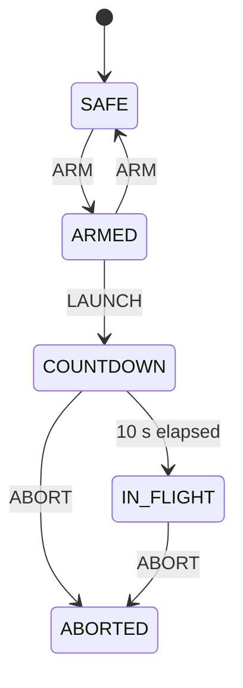
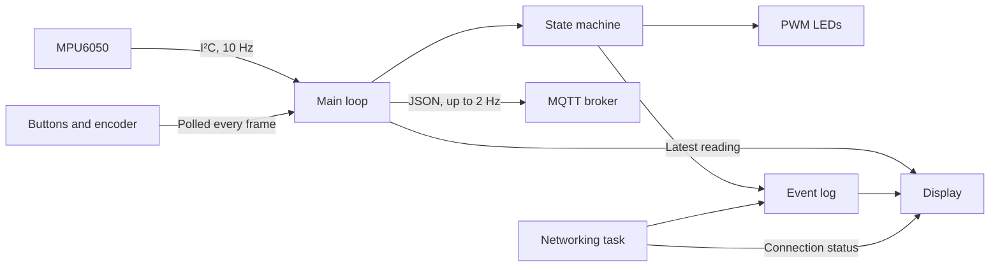

<div align="center">

# LAUNCHER

**A pocket mission-control unit for the LilyGO T-Display S3, written in C on ESP-IDF.**


</div>

Launcher turns a T-Display S3 into a small flight console. Physical buttons drive a launch sequence through a state machine, a rotary encoder moves between four live screens, and an MPU6050 streams motion data to the display and over MQTT. Status LEDs pulse with each mission phase, and a ring-buffer log records everything that happens along the way.

## Features

- Mission state machine with a 10-second countdown and flight timer
- MPU6050 acceleration, rotation and temperature readings over I²C at 10 Hz
- Wi-Fi and MQTT telemetry published as JSON at up to 2 Hz
- Four screens: mission, sensor telemetry, communications and event log
- Rotary encoder navigation with a quadrature decoder
- PWM status LEDs with a different pattern for each state
- 16-entry ring-buffer event log with timestamps
- Networking runs in its own FreeRTOS task, so the interface stays responsive

## State machine



`ABORTED` is final until the board restarts. A `LANDED` state and its screen and LED pattern are defined, but no transition leads to it yet.

| State | Green LED | Blue LED | Red LED |
| --- | --- | --- | --- |
| SAFE | Slow pulse | Off | Off |
| ARMED | On | Pulse | Off |
| COUNTDOWN | Off | On | Pulse, faster near launch |
| IN FLIGHT | Off | On | Slow pulse |
| LANDED | On | Off | Off |
| ABORTED | Off | Off | On |

## Architecture

| Module | Responsibility |
| --- | --- |
| `main.c` | Start-up, main loop, state machine, screens, encoder and LED patterns |
| `mpu6050.c` | I²C driver, sensor setup and conversion to physical units |
| `networking.c` | Wi-Fi and MQTT event handling, telemetry publishing |
| `wifi.c` | Wi-Fi station setup and connection |
| `event_log.c` | Fixed-size ring buffer of timestamped events |
| `leds.c` | LEDC PWM setup and brightness control |
| `input_output.c` | Button GPIO setup and NVS storage helpers |

### Data flow



The main loop runs about every 20 ms. It polls the inputs, reads the IMU every 100 ms, updates the mission state and redraws the selected screen. While MQTT is connected, it publishes the latest reading at most every 500 ms.

## Hardware

Built for the **LilyGO T-Display S3**.

| Component | Signal | GPIO |
| --- | --- | --- |
| MPU6050 | SDA | 16 |
| MPU6050 | SCL | 21 |
| Rotary encoder | CLK | 43 |
| Rotary encoder | DT | 18 |
| Rotary encoder | SW (configured, not used) | 17 |
| ARM button | Active low | 1 |
| LAUNCH button | Active low | 2 |
| ABORT button | Active low | 3 |
| Green LED | PWM | 10 |
| Blue LED | PWM | 11 |
| Red LED | PWM | 12 |

Buttons and the encoder use the internal pull-ups. The MPU6050 is at I²C address `0x68` and runs at 50 kHz.

## MQTT

| Setting | Value |
| --- | --- |
| Topic | `launcher/telemetry/neo-s3-01` |
| QoS | 0 |
| Retain | No |

Each message is a JSON object:

```json
{
  "accel_x": 0.12,
  "accel_y": -0.05,
  "accel_z": 9.79,
  "gyro_x": 0.4,
  "gyro_y": -1.2,
  "gyro_z": 0.1,
  "temperature_c": 24.6
}
```

Acceleration is in m/s², rotation in degrees per second and temperature in °C. The broker address is set in `src/networking.c`.

## Build and flash

You'll need [PlatformIO](https://platformio.org/). Start by creating `src/wifi_config.h`, which is ignored by Git:

```c
#ifndef WIFI_CONFIG_H
#define WIFI_CONFIG_H

#define WIFI_SSID "your-network"
#define WIFI_PASSWORD "your-password"

#endif
```

Then build and run:

```bash
# Build and flash a T-Display S3
pio run -e tdisplay_s3 -t upload

# Watch the serial output
pio device monitor

# Run in the emulator
pio run -e emulator_s3 -t upload
```

## Credits

- [TDisplayGraphics](https://github.com/a159x36/TDisplayGraphics) by a159x36: display, font and drawing library
- [T-Display emulator](https://github.com/a159x36/qemu) by a159x36: QEMU-based emulator
- [ESP-IDF](https://github.com/espressif/esp-idf) by Espressif: framework, drivers and MQTT client

## Licence

Available under the [MIT licence](LICENSE).
